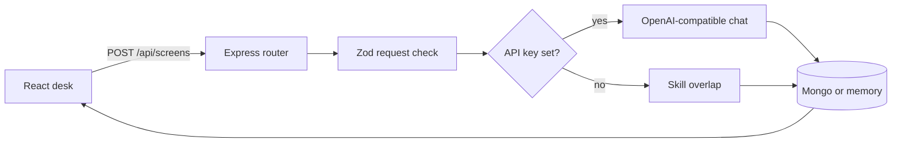

# Developer notes

This file is the map of the code. Read it before changing a route or the prompt. The product explanation for someone running the app is in [README.md](README.md).

## Shape

Two packages, one repo, npm workspaces.

```text
client/     React + Vite. Talks only to /api.
server/     Express. Owns validation, the model, and storage.
```

The client does not import server files. The screen contract is duplicated in `client/src/types.ts` and `server/src/types.ts` on purpose. A shared package would be a third workspace for one interface. If you add a field, change both types and the Zod schema that actually enforces the model output.



## Request path

1. `client/src/App.tsx` submits the form through `client/src/api.ts`.
2. `server/src/routes/screens.ts` parses the body with `screenRequestSchema`. A failed parse is a 400 with one sentence, not the raw Zod tree.
3. `screenPair` in `server/src/ai/screen.ts` either calls the model or `heuristicScreen`.
4. The store inserts the input plus the result. The response is the saved record, including its id, so the UI can select it without a second fetch.
5. Errors from the store or an unexpected throw hit the handler in `server/src/app.ts` and become a 500 `{ error }`.

`GET /api/health` is how the header knows whether it is showing a model name or the words "offline overlap". The handler does not return the API key.

## Model contract

`modelResultSchema` is the only shape we accept from a model:

- `score` number 0–100
- `summary` string
- `matchedSkills`, `missingSkills`, `risks`, `rewrittenBullets` string arrays, with caps

`source` and `model` are set by our code after parsing. The model is not allowed to claim it is the offline checker, and the offline checker is not allowed to claim it is a model.

Flow inside `fromModel`:

1. Ask with `response_format: json_object`.
2. If that flag is rejected by the provider, retry the same prompt without it.
3. Strip optional markdown fences in `extractJson` and run Zod.
4. On invalid JSON, ask once more, quoting a clipped reason.
5. If that still fails, or the HTTP call fails, return the heuristic result and put the failure in `risks`. The user still gets a saved screen, and the badge still says the result is offline.

The system prompt's important rule: a skill is matched only when the resume text supports it, and a rewritten bullet cannot introduce a new fact. That is the behavior you should be able to defend in an interview. The code does not have a second checker that proves the model obeyed. Zod checks shape, not truth.

Temperature is `0.2` so repeated runs on the same pair stay closer.

## Offline checker

`heuristicScreen` is not a miniature model. It does four things:

- Looks for a fixed skill list with a boundary regex, so `java` would not match inside `javascript` and `git` does not match inside `GitHub`.
- Takes the skills that appear in the job. If the job names none of them, the score stays low and a risk says the vocabulary was missing.
- Score = matched / (matched + missing), rounded. No match at all is 40 only when the job also named nothing, otherwise it is 0.
- Rewritten bullets are resume lines, trimmed and capitalized. They never receive a skill the resume did not already contain.

That last point is why the test asserts the sample bullets do not gain React, Docker, or Kubernetes.

## Storage

`ScreenStore` in `server/src/types.ts` is the seam: `insert`, `list`, `get`, `remove`.

- `createMemoryStore` keeps an array in the process. Newest first. Used when `MONGO_URI` is empty so `npm run dev` works with zero infrastructure. Data dies with the process. Say that out loud if you demo it.
- `createMongoStore` connects with Mongoose and maps `_id` to `id` at the edge. Callers never see an ObjectId. Invalid ids return null instead of throwing, so a bad id is a 404.

`connectStore` is the only place that chooses. Routes take a `ScreenStore`, which is why `memory.test.ts` does not need a database.

Documents are not user-scoped. There is no account system. Do not store real resumes on a shared server until that exists.

## UI

`App` holds the form, the selected screen, and the history list. There is no global store. The selected screen is an id into the list, not a second copy, so a delete cannot leave a stale detail on screen.

`Load sample` fills the same fields a recruiter would paste. It does not skip the API. You can watch the network call.

The score is a number, not a ring gauge, because a gauge implies more precision than a keyword overlap or a single chat completion has.

Styles live in one file. The ink rail and the serif headline are there so the page reads as a hiring desk rather than a generic chat landing page.

## How to change it

Add a result field:

1. Extend `modelResultSchema` and both `ScreenResult` types.
2. Teach `heuristicScreen` to fill the field with something honest.
3. Render it in `Result` inside `App.tsx`.
4. Add or adjust a test. The model path is not unit-tested against a live API. Test the parser, the schema, and the heuristic.

Add an endpoint:

1. Put it on `screensRouter` or a new router mounted from `createApp`.
2. Validate with Zod.
3. Call the store. Do not reach into Mongoose from the route.

Swap the model provider:

Set `OPENAI_BASE_URL` and `OPENAI_MODEL`. The SDK call is already provider-agnostic. If a provider needs a different auth header, that is a new client, not a change to the route.

## Tradeoffs

- In-memory fallback makes the repo runnable in a portfolio review. It is the wrong store for anything private or multi-instance.
- Falling back to the heuristic when the model fails keeps the demo alive. It can also hide a bad key. The risk string is the signal. The health badge is the other one.
- Duplicated types will drift if you only edit one side. The API response is the runtime contract. TypeScript will not catch a client that forgot a new field until you use it.
- `Mixed` for the Mongo result is deliberate. The result shape is owned by Zod at write time. A rigid Mongoose subschema would reject old rows the moment the JSON gained a key.

## Interview walkthrough

If someone asks you to explain this repo, walk this path and stop where they interrupt:

1. The UI never calls a model. It only posts text to Express.
2. Zod rejects short or huge payloads before any token is spent.
3. The model must return JSON. We parse it, check it, and retry once.
4. We label heuristic results so a missing API key cannot look like GPT.
5. Mongo is optional behind a store interface. Tests hit the memory implementation.
6. There is no auth, so the README tells you not to deploy it with real resumes.

## What I would not add next without a reason

Login, a vector database, a score explanation model, or a PDF parser. Each one is a new product. The current gap that matters is truthfulness of the match, not more screens.
